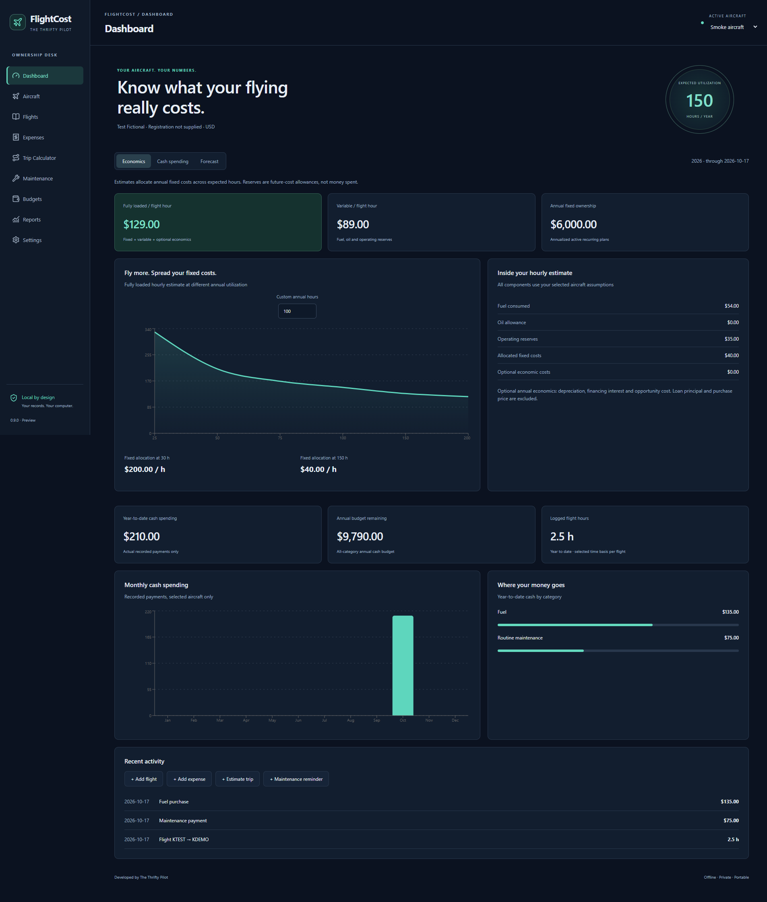
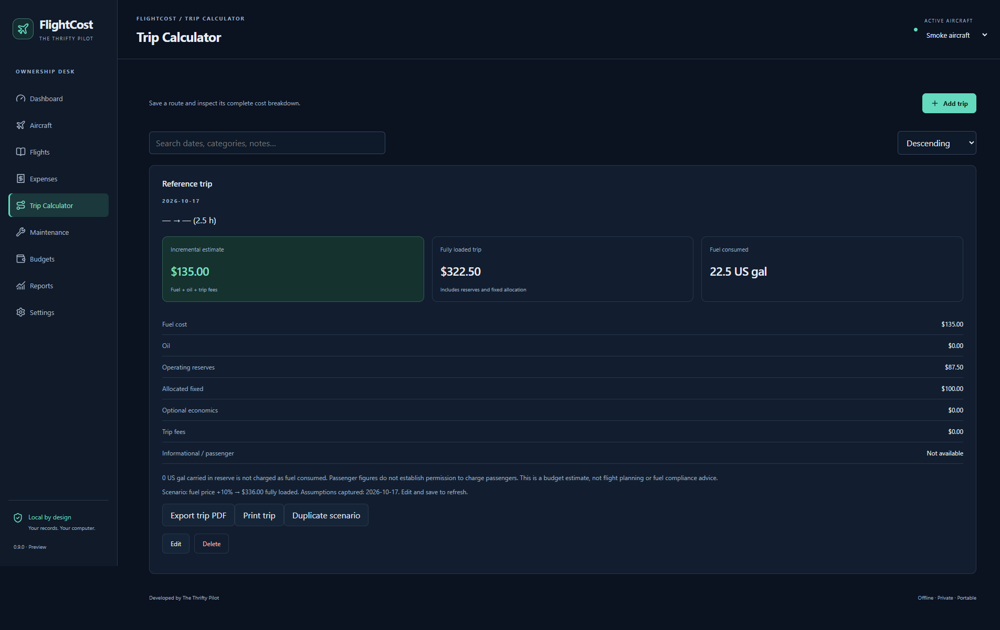

# FlightCost

**Know what your flying really costs.** Developed by The Thrifty Pilot.

FlightCost is a Windows desktop app for aircraft owners who want to understand what they spend and what their flying really costs. Track payments and receipts, log flight hours, estimate trips, plan recurring expenses, and see how flying more or less changes your cost per hour. Your records stay in a local SQLite database, with backup and export tools you control. There are no accounts, subscriptions, advertisements, cloud synchronization, or telemetry.

## Status

Version 0.9.0 is an unsigned Windows preview, not a production release. See [test results](TEST_RESULTS.md) for observed checks and [release notes](RELEASE_NOTES.md) for remaining scope. No source-code license has been selected.

## What does an hour really cost?

A $2,400 annual insurance bill costs **$80 per flight hour at 30 hours a year**, or **$16 per hour at 150 hours**. The payment is the same; the economics of each hour change with utilization.

| View | Meaning |
| --- | --- |
| Recorded cash | Payments actually entered, with capital and financing classifications kept separate. |
| Operating economics | Estimated fuel, reserves, allocated fixed costs, and selected ownership assumptions. |
| Committed forecast | Recorded cash plus unpaid scheduled installments; not a prediction of every future expense. |

Reserve allowances are estimates, not money deposited into a reserve account. See [calculation methodology](CALCULATIONS.md) for formulas and examples.

## Core features

- Multiple aircraft, editable assumptions, archiving, and profile duplication.
- Decimal-based calculation services, US gallon/liter conversion, utilization sensitivity, manual or derived engine reserve.
- Cash payments, aircraft-scoped flight links, recurring plan reconciliation, local receipts, CSV import/export.
- Manual, Hobbs or tach flight duration; saved multi-leg trip scenarios.
- User-defined maintenance reminders, annual/month/category cash budgets.
- Ownership PDF reports and printing, local SQLite backup verification and transactional restoration.
- Optional clearly labeled fictional Warrior profile, separated by aircraft identity.
- Dark and light themes; no network dependency for normal operation.

## Install on Windows

**Requires Windows 11 x64.** No Node.js, Python, database server, or account is needed to use the installer.

1. Open [Releases](https://github.com/thethriftypilot/FlightCost/releases) and choose the Windows preview.
2. Under **Assets**, download `FlightCost-Setup-0.9.0.exe` and `SHA256SUMS.txt`. GitHub's source-code ZIP is not an installer. If no installer is listed yet, use the source-build instructions below.
3. Compare the installer's SHA-256 checksum with `SHA256SUMS.txt` using `Get-FileHash` in PowerShell.
4. Close FlightCost if it is running, run the installer, and choose the installation folder.
5. Launch **FlightCost** from the Start menu. Add your aircraft and assumptions, or explore the clearly labeled fictional example.
6. Use **Settings → Create verified backup** after entering records you want to keep.

The preview installer is unsigned, so Windows may show an unknown-publisher warning. Verify the source and checksum before deciding whether to run it. See the [full installation and recovery guide](INSTALLATION.md).

## Requirements and development

Windows 11 x64. End users do not need Node.js or Python. Development requires Node.js 24+, npm and Windows for installer validation.

```powershell
npm ci
npm test
npm run build
npm start
npm run smoke
npm run package
```

`npm ci` uses the project lockfile. The first Electron invocation may download its runtime. `npm run package` creates the NSIS installer under `dist`. Run `scripts/icon.ps1` only when regenerating the original geometric application icon.

## Privacy and portability

The database lives in `%APPDATA%\FlightCost\flightcost.sqlite`. Receipts are stored as database BLOBs, so a verified SQLite backup includes their contents. Backups are not encrypted. Store them privately and keep a separate copy on a trusted drive. Never copy a live WAL database manually; use Settings → Create verified backup.

JSON exports provide portable structured records and receipt metadata. CSV exports contain the selected aircraft's payments. SQLite backups are the complete recovery format. Restore validates schema, records and relationships, saves an automatic recovery backup, and replaces current tables in one transaction.

## Architecture

`src/domain` is the authoritative model and financial layer. `electron/database.ts` owns persistence, migration and recovery. `electron/main.ts` implements validated IPC and native file dialogs; `preload.ts` exposes only named operations. React pages cannot access arbitrary filesystem paths. Renderer Node integration is disabled, sandbox and context isolation are enabled, navigation and permissions are blocked, and CSP denies network connections.

SQLite uses the Node SQLite module bundled in Electron rather than a separately rebuilt native addon. This reduces ABI packaging risk. The runtime currently marks this API experimental; tests must be repeated when upgrading Electron. The schema uses normalized ownership/reference columns and validated JSON payloads for evolving assumptions, with receipt BLOBs and indexed aircraft relationships.

## Documentation

Read the [user guide](USER_GUIDE.md), [calculation methodology](CALCULATIONS.md), [installation guide](INSTALLATION.md), [test results](TEST_RESULTS.md), and [release notes](RELEASE_NOTES.md). Support website: [The Thrifty Pilot](https://www.thethriftypilot.com). The optional support URL is blank until configured by the user/publisher.

Technical references: [Electron security guidance](https://www.electronjs.org/docs/latest/tutorial/security/) and [SQLite backup guidance](https://sqlite.org/backup.html). No aircraft performance or cost values are fetched from external sources; demonstration assumptions are fictional.

## Screenshots

Captured from the tested desktop application using fictional test records:





## Feedback and licensing

When reporting problems, include the app version, Windows version, reproduction steps, and expected versus actual behavior. Use fictional records and remove financial information from screenshots. Do not post databases, receipts, or backups in public issues.

This project does not currently declare an open-source license. Third-party dependencies retain their respective licenses.
